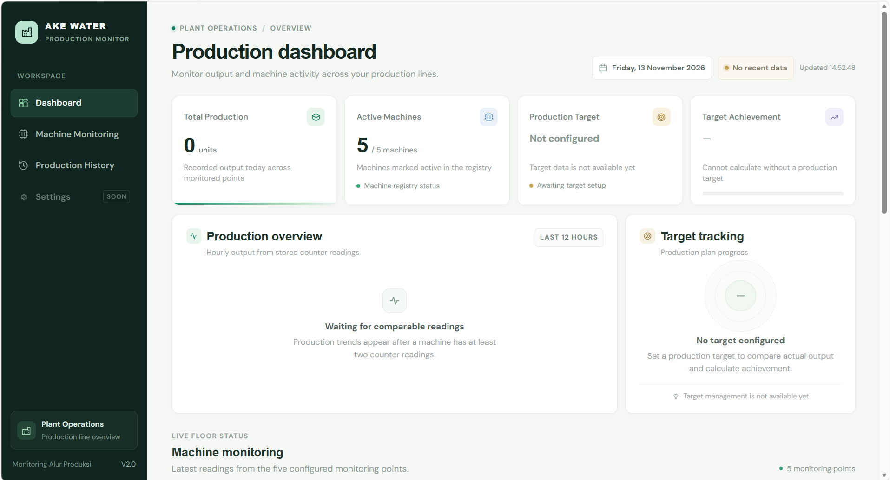

# Monitoring Alur Produksi 

A Laravel-based production monitoring dashboard for a bottled drinking water production facility. The application stores machine counter readings, summarizes production from consecutive readings, and provides a local simulator for development and demonstrations.

> This repository is a portfolio project. It does not include production data or a live integration with the Sanco IoT system.

## Project Objectives

- Centralize counter readings from configured production monitoring points.
- Show current machine counters, data freshness, and production summaries.
- Review historical readings with machine, source, and date filters.
- Exercise the counter-recording workflow locally before an external data source is available.

## Key Features

- Responsive production dashboard with machine status and recent activity.
- Hourly production overview for the last 12 hours and a total derived for the current day.
- Dashboard data polling every five seconds; polling pauses while the browser tab is hidden.
- Paginated production history with date, machine, and source filters.
- Transactional counter recording through a shared service.
- Local counter simulator guarded to the `local` and `testing` environments.
- Empty states when no applicable machine or reading data exists.

## Dashboard Monitoring

The dashboard is available at `/` and includes:

- Total production for the current day, calculated from consecutive counter readings.
- Active machine count from the machine registry.
- A 12-hour hourly output chart and up to eight recent readings.
- Cards for the five configured monitoring points: Filling Gallon, Filling Bottle 1, Filling Bottle 2, Filling Cup 1, and Filling Cup 2. Additional machines in the registry are also included.
- A freshness indicator based on the most recent received reading. The configured default stale threshold is five minutes.
- A dashboard data endpoint at `GET /dashboard/data`, polled by the page every five seconds.

Production targets are not configured, so target and achievement values are intentionally shown as unavailable.

## Production History

Open `/production-history` to review stored readings, including machine name and code, counter value, unit, source, observed and received timestamps, and a calculated production delta.

The page supports start date, end date, machine, and source filters. Results are paginated at 25 readings per page, and selected filters are retained between pages. Dates are interpreted using the application timezone, which is `UTC` in the current configuration.

The delta is calculated against the preceding reading for the same machine, even if that preceding reading falls outside the current filter. A first reading has no delta; a lower counter is shown as a decrease and is not reported as negative production. Deltas are not stored in a separate database column.

## Machine Counter Simulation

The `production:simulate` Artisan command generates local readings for the five configured monitoring points. It creates a configured machine only when its code is not already registered, then sends each reading through `ProductionCounterService`; the command does not create reading records directly.

The simulator starts a new counter at zero and increases it by a configured amount on subsequent readings (2 gallons, 12 bottles, or 24 cups per interval). It continues from the latest stored counter when run again and does not clear existing data. The default interval is five seconds.

## Data Flow

The implemented local flow is:

```text
Local simulator
    -> production:simulate command
    -> ProductionCounterService
    -> machines and counter_readings tables
    -> dashboard/history controllers
    -> Blade pages
```

The service validates that the machine exists and is active, records the raw counter value and timestamps, and calculates an increase against the previous reading when possible. Counter values are handled as non-negative integers and stored in an unsigned BIGINT column. The dashboard and history derive summaries from stored readings.

The future Sanco data flow is not implemented. No Sanco endpoint, authentication contract, or payload format is assumed by this project.

## Technology Stack

- PHP `^8.2`
- Laravel `^12.0`
- Blade templates
- Tailwind CSS `^4.0`
- Vite `^6.0`
- SQLite by default; MySQL is also configured as a supported connection
- PHPUnit `^11.5` for tests

The version constraints above are taken from the project manifests; installed patch versions may vary.

## Requirements

- PHP 8.2 or newer with the SQLite PDO extension enabled for the default setup.
- Composer.
- Node.js and npm compatible with the Vite version in `package.json`.
- Git.

MySQL can be used instead of SQLite if a MySQL server and the PHP PDO MySQL extension are available.

## Installation and Setup

Clone the repository and install dependencies:

```bash
git clone <repository-url>
cd monitoring-produksi-v2
composer install
npm install
```

Create the local environment file. On PowerShell:

```powershell
Copy-Item .env.example .env
```

On macOS or Linux:

```bash
cp .env.example .env
```

Generate the application key, create the default SQLite file if it does not exist, and run migrations:

```bash
php artisan key:generate
php -r "if (! file_exists('database/database.sqlite')) { touch('database/database.sqlite'); }"
php artisan migrate
```

The SQLite database file is local development state and is excluded from Git by `.gitignore`.

## Database Configuration

The checked-in `.env.example` selects SQLite:

```dotenv
DB_CONNECTION=sqlite
```

Laravel uses `database/database.sqlite` by default. No database credentials are required for this setup.

To use MySQL instead, create an empty database, set `DB_CONNECTION=mysql` in your local `.env`, and provide the database host, port, name, username, and password in the `DB_*` variables. Then run `php artisan migrate`. Do not commit the local `.env` file or real credentials.

## Migrations and Seeding

Apply the project migrations with:

```bash
php artisan migrate
```

The migrations create Laravel's user/session, cache, and queue tables, along with `machines` and `counter_readings`. Use `php artisan migrate:status` to inspect migration state.

No machine or counter-reading seeder is provided; the simulator creates its configured machines when it runs. The existing `DatabaseSeeder` only inserts a Laravel starter test user (`test@example.com`) through `UserFactory`. Seeding is not required for the dashboard and should not be run against a public or production database.

## Running the Application

Run the Laravel development server and Vite in separate terminals:

```bash
php artisan serve
```

```bash
npm run dev
```

Open the URL printed by `php artisan serve` (usually `http://127.0.0.1:8000`). Build frontend assets with `npm run build`.

## Running the Production Simulator

Run one reading for each configured machine and exit:

```bash
php artisan production:simulate --once
```

Run continuously, using the five-second default interval:

```bash
php artisan production:simulate
```

Override the interval for a run:

```bash
php artisan production:simulate --interval=10
```

The simulator only runs when `APP_ENV` is `local` or `testing`. It persists counter readings in the selected database; use a development database when demonstrating this command. Stop a continuous run with `Ctrl+C`.

## Testing

Run the complete Laravel test suite:

```bash
php artisan test
```

`phpunit.xml` configures tests to use an in-memory SQLite database, separate from the normal application database. The suite covers counter recording, machine relationships, simulator behavior, dashboard data, history filters, pagination, and empty states.

## Application Screenshots

### Production Dashboard

The main dashboard summarizes daily output, data freshness, and recent production activity.



### Machine Monitoring

Machine cards show the latest counter and status for each configured monitoring point.


### Production History

The history page presents stored counter readings and production deltas.


## Limitations and Future Improvements

- The Sanco IoT API is not integrated; its endpoint, payload, and authentication contract are not available in the source.
- Production targets and target achievement are not configured.
- Shift schedules, runtime, downtime, and machine performance calculations are not implemented.
- The simulator is for local development and demonstrations, not a production data source.
- The current routes do not implement user authentication or authorization.
- Potential next steps include confirming the Sanco integration contract, adding configurable production targets and flexible shifts, implementing access control, and adding operational monitoring for runtime and downtime.
